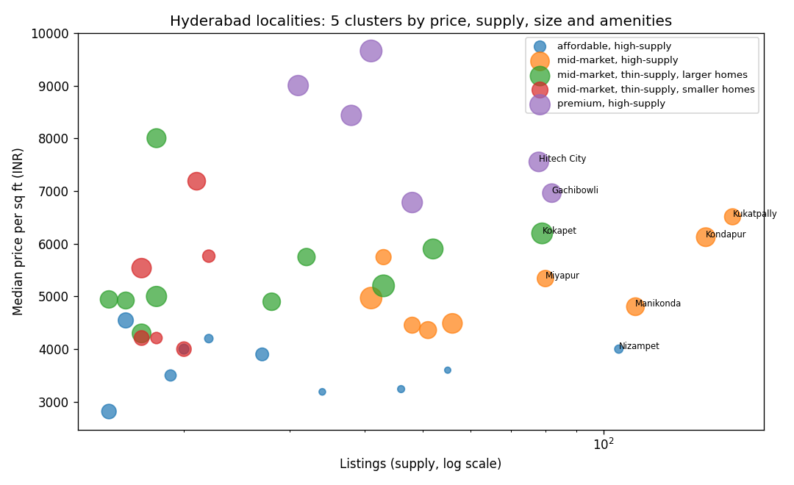

# Hyderabad Housing Analytics: Resale Price Prediction and Locality Clusters

Two questions a property platform asks about a city: **what is a home worth**, and **where are the gaps and
growth opportunities**? Answered with real Hyderabad listings (price, area, bedrooms, new vs resale, locality,
~35 amenities) from the public Kaggle dataset "Housing Prices in Metropolitan Areas of India".



## Key results
- **Data:** 2,464 Hyderabad listings after cleaning (552 resale) across 238 localities; median price INR 77 lakh, median INR 5,000 per sq ft.
- **Price prediction (5-fold cross-validation):** gradient boosting is most accurate (median error 6%, MAE INR 11.7 lakh, R² 0.91); the multivariate regression is less accurate (median error 10%, R² 0.87) but explains the drivers.
- **What drives price:** the locality's price level is by far the strongest driver. Each 1% more area adds about 1.2% to price, while an extra bedroom in the same area lowers it by about 3%: buyers pay for space, not room count. Each listed amenity adds about 0.4%. All VIFs are below 4, so the drivers don't overlap.
- **Resale vs new:** resale homes list higher per sq ft (INR 5,609 vs 4,990), most likely because they sit in established central areas while new projects are on the city's edges.
- **Locality clusters:** 41 localities with 15+ listings fall into 5 clusters, from affordable high-supply suburbs (about INR 3,750/sq ft) to premium hubs (about INR 8,000/sq ft).
- **Gap, premium but thin supply (inventory to win):** Madhapur, Sanath Nagar, Begumpet, Malkajgiri and Nallagandla.
- **Volume hubs (most lead volume and competition):** Kukatpally (164 listings), Kondapur (148), Manikonda (113), Nizampet (106), Gachibowli (82).

## 1. Price prediction
- **Multivariate regression** on log price: log area, bedrooms, resale flag, amenity score and the locality's price
  level (target-encoded inside each cross-validation fold, so test prices never leak into training). Coefficients
  read directly as % effects, and variance inflation factors check that predictors don't overlap too much.
- **Gradient boosting** on the same features plus every amenity, for accuracy.
- Both are compared with 5-fold cross-validation: error in INR lakh, median % error, and R² on log price.

## 2. Locality clusters and gaps
Each locality with 15+ listings is described by median price per sq ft, supply (listings), median size, share of
3BHK+, amenity score and resale share. K-means groups them (k chosen by silhouette score), and each cluster is named
by price level and supply. Two kinds of gap are flagged:
- **Premium but thin supply:** high price per sq ft and few listings, inventory worth winning.
- **Volume hubs:** the most listings, where lead volume is highest and competition is strongest.

## Limits
Listing prices are asking prices, not transaction prices; the data is a scraped snapshot with no time dimension,
so "growth" here means gaps in today's market, not price trends. Amenity fields are often blank (coded 9).

## Run it
```bash
pip install -r requirements.txt
pytest -q
# put Hyderabad.csv from the Kaggle dataset into data/
python run.py
```
